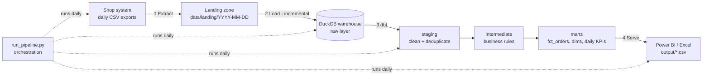

# Shop Data Pipeline: End-to-End ELT with Python, DuckDB and dbt

**Portfolio project by Dhrukumar Valand. All data is simulated.**

A small but complete data pipeline, built the way modern data teams work:
raw data from source systems is **loaded incrementally** into a **data warehouse**,
**transformed with SQL in dbt** into clean, tested tables, and **served** to BI tools
like Power BI.

## The business case

An online shop sells coffee, tea, spices and equipment to customers in Germany,
Italy, India and the Netherlands. Every day, its systems export orders, payments,
refunds, customers and products. Management wants one reliable answer to
*"How much did we really earn, per day and per country?"*

The source data is messy, like in real life:

| Problem in the source data | How the pipeline fixes it |
|---|---|
| Files re-sent by the source (duplicate rows) | Deduplication with `row_number()` in staging |
| Orders sent again later with a new status (late-arriving updates) | Keep order details + the **latest** status |
| 13 spellings of 4 countries ("DE", " germany ", "Deutschland"…) | Standardised country mapping |
| Amounts with comma decimals ("12,50") | Converted to proper numbers |
| Mixed-case e-mails | Lower-cased and trimmed |
| Refunds without amounts, cancelled orders never paid | Business rules in one place (`int_order_financials`) |

## Architecture



| Step | What happens | Where |
|---|---|---|
| **1. Source** | The shop system drops daily export files (simulated) | `scripts/generate_source_data.py` |
| **2. Extract + Load** | New daily batches are loaded **as-is** into the `raw` schema with metadata (`_batch_date`, `_source_file`, `_loaded_at`). A load log makes it **incremental and idempotent**: already loaded days are skipped, re-running never duplicates data | `scripts/ingest.py` |
| **3. Transform** | dbt builds 3 layers: **staging** (clean each table), **intermediate** (combine + business rules), **marts** (star schema + KPI table) | `shop_dbt/models/` |
| **4. Test** | **35 dbt models and data tests** run on every build: unique keys, not-null, accepted values, relationships between tables, plus custom business rules. If a test fails, the pipeline stops and no bad data is published | `shop_dbt/models/*/schema.yml`, `shop_dbt/tests/` |
| **5. Serve** | Mart tables are exported for Power BI / Excel | `output/` |
| **6. Visualize** | A ready-made **Power BI project** (`powerbi/Shop_Dashboard.pbip`): star schema with relationships, 8 DAX measures (net revenue, orders, customers, cancel rate, refund rate, average order value…) and two dashboard pages. The data source is a parameter that points to this repo's `output/` files, so it opens on any computer and can be refreshed in the Power BI Service (cloud) | `powerbi/`, `scripts/build_powerbi_project.py` |

This is the **ELT** pattern (Extract, Load, then Transform inside the warehouse),
with the **medallion idea** of raw → clean → business-ready layers.

## Data model (marts)

- `fct_orders`: one row per order. Gross amount, paid amount, refunds, **net revenue**, status, country, category
- `dim_customer`: one row per customer, with first order date and lifetime orders
- `dim_product`: one row per product with the latest price
- `mart_daily_revenue`: daily KPIs per country (orders, customers, gross, refunds, net revenue, cancel rate, unpaid rate)

A star schema (fact + dimensions) is exactly what Power BI works best with.

## Results (30 simulated days)

```
orders:    2,742 raw rows (incl. duplicates + status updates) -> 1,599 clean orders
customers: 192 raw rows -> 183 unique customers
country spellings standardised: 13 variants -> 4 countries
amounts fixed from comma format ('12,50'): 117
gross EUR 57,794.50 | paid EUR 51,354.50 | refunds EUR 2,846.94 | net revenue EUR 48,507.56 | cancel rate 5.4%
dbt build: PASS=35 WARN=0 ERROR=0
```

Running it again with one more day **only loads the new day** (incremental).
See `docs/run_output_day30.txt` and `docs/run_output_day31_incremental.txt`.

## How to run

```bash
pip install -r requirements.txt
python run_pipeline.py --days 30      # first run: 30 days of history
python run_pipeline.py --days 31      # next "day": only the new batch is loaded
```

Run commands from the repository root. Explore the warehouse with DuckDB:

```bash
duckdb warehouse/shop.duckdb "select * from marts.mart_daily_revenue limit 10"
```

## Power BI dashboard

Open `powerbi/Shop_Dashboard.pbip` in **Power BI Desktop** (Windows). On first load, Power BI asks how to access the web source: choose **Anonymous** and **Connect**. The two pages build automatically:

- **Sales Overview**: KPI cards (net revenue, orders, customers, cancel rate), net revenue per day, by country and by product category, with a country filter
- **Products & Refunds**: gross sales, refunds, refund rate, average order value, revenue by product, orders by status

To use local data instead, change the `DataUrl` parameter (Transform data → Edit parameters). After publishing to the Power BI Service, a scheduled refresh keeps the dashboard up to date after every pipeline run.

The Power BI project is generated by `scripts/build_powerbi_project.py` (TMDL semantic model + PBIR report), so the dashboard itself is version-controlled like code.

## Tools

Python · pandas · **DuckDB** (warehouse) · **dbt** (SQL transformations, tests, lineage) · SQL (CTEs, window functions) · Power BI-ready star schema

## What I would add in a company setting

- **Orchestration** with Airflow, Dagster or Azure Data Factory instead of one script
- A cloud warehouse (Snowflake, BigQuery, Databricks or Microsoft Fabric) instead of a local DuckDB file
- dbt **incremental models** and **snapshots** (history of changing customer data)
- Alerting when tests fail
